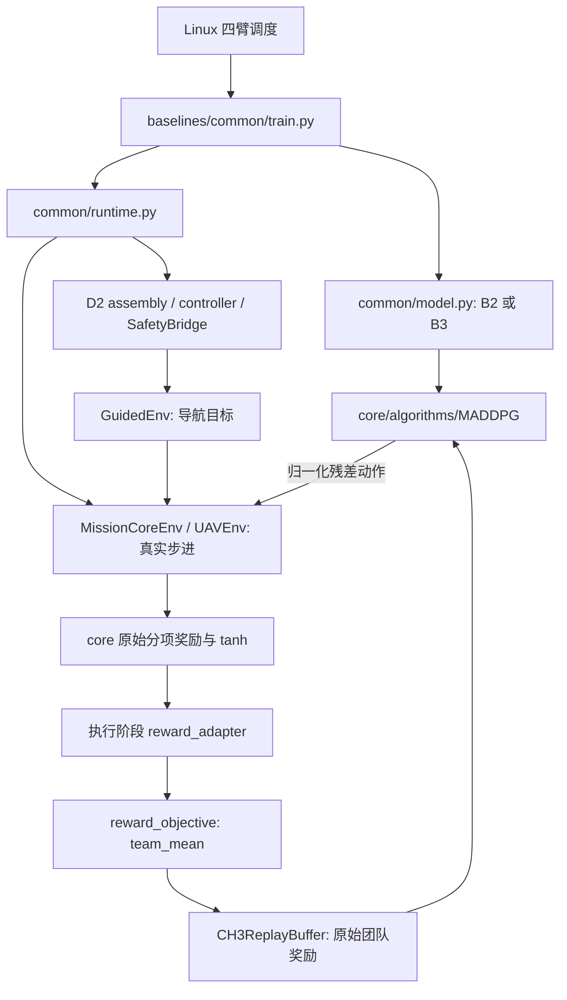

# MADDPG 与 D2/B2/B3 底层审查（2026-10-18）

本轮结论：目前不能给出“底层无错、可直接开展正式创新实验”的验收结论。已复现一个实际奖励事件缺陷，确认一个训练与物理动作冻结的衔接风险；连续 MADDPG 有效有限输入主路径未发现维度、梯度方向、replay 对齐、目标网络复制或基本终止公式错误。不同结论的证据等级必须区分。

## 对上一轮修改的纠正

撤回把 `long_horizon_maddpg_v1` 推荐为“已经解决后续发现问题”的结论。它是未采纳的实验提案，不是已验收修复，不应据此重跑正式实验。旧 B2/B3 的 gamma 仍是 0.95，本轮没有改它们。

改变 gamma 会改变所有未来奖励的时间权重，不只影响发现奖励。上一轮同时改变输入缩放、actor 更新频率、探索、学习率、冻结样本处理和价值截断，又没有先验证奖励排序和单因素对照；不能根据实现检查通过便宣布目标合理。

用相同奖励序列计算：每步 +0.001、持续400步的折扣和，从 gamma=0.95 时的约0.0200变成 gamma≈0.998269 时的约0.2888。距离当前150个折扣间隔的碰撞罚 -2，其贡献也从约 -0.000911变成 -1.54221。发现、覆盖、能耗、平滑、碰撞都被重新加权，不是只补偿晚发现。50%保留率是人为选择，没有任务性能证据支持。

## 范围与可核验边界

- 全仓排除 test、缓存、输出和 tmp 后，扫描369个 Python 文件、68,533行，包含 core 44个、chapter3_bser 251个。全部做 AST、符号、导入与入口检查；另核查配置和启动器结构。
- 对 MADDPG、B2/B3 模型和真实训练调度、replay、动作映射、奖励、发现/交接/终止、guidance 和四臂评估主链做进一步源码核查和独立运行探针。
- 这不是369个文件逐行语义证明，更不是保证任意输入、设备、历史入口和未启用方法无错。目录职责索引不能替代算法正确性证明。
- 不以现有 test 作为本轮审查依据，不运行 pytest，不加载用户权重，不启动训练实验，不改生产代码、配置、历史来源清单或用户 outputs。
- 33个关键文件逐字节匹配用户 Linux 日志声明的 source `84d403cd…236a9` 所对应的 `d2_performance_v1/git_clone_preserved` 档案。这关联了缺陷与实验源码身份，不代表远程检查过 Linux 磁盘。
- 全部27条历史来源记录及目标文件仍存在；完整当前父档案 `d2_performance_v2/windows_existing` 的既有文件仍匹配。未放宽任何来源检查。

[逐目录、逐文件职责索引](DIRECTORY_GUIDE.md) · [369文件机器可读索引](SOURCE_CATALOG.csv) · [本轮紧凑证据](evidence.json)

## 实际学习链路

这里有两套配置来源，不能只改一处默认值：

1. 学习设置实际来自 `configs/chapter3/d2_v1/direct_mc_train.json` 或 `direct_boundary_train.json` 的 `rl`。
2. core 物理与原始奖励由 `build_ch3_config` 经 v3 registry 和 `core/runtime/engine.py` 的历史配置解析；JSON 的 `reward` 是之后的执行奖励 adapter，不包含全部原始奖励权重。

实际奖励依次为：原始进展/覆盖/分散/事件/成本求和 → 每个 agent 的 tanh(raw/400) → 发现奖励恢复和发现后搜索者清零 → 执行者接触/保持/成功附加项及 clip → 四 agent 均值 → 把同一个团队奖励复制到四个 critic 的兼容接口。没有发现学习奖励被多平均一次或乘四的错误。

## A. 已确认、需要先处理的问题

### A1：航点到达 bonus 的事件顺序错误，当前任务分支实际可达

位置：`core/env/uav_env.py:2401,2468,2469,1262`。

移动目标/未知地图分支先清除 `just_reached_waypoint`，然后计算奖励，最后才调用 `_update_search_path_events()` 设置标志；下一步又清除。奖励函数读取标志发放的 waypoint bonus 因而错过事件。

本轮使用真实环境和真实动力学，只将一个内部搜索航点置于当前合法位置以构造到达情形。两步后航点计数0→1，但两个奖励计算时点的到达标志均为 false。第二步的 coverage 分项仍有4.625，说明并非所有覆盖/进展奖励都为零；缺失的是对应的到达事件项。

这不是 MADDPG 反向传播错误，但直接影响它学到的目标。高层 D2 外部 guidance 航点与环境内部 `_search_waypoints` 不是同一个对象，所以不能仅交换两行就宣布修复。必须先定义奖励针对内部航点还是实际执行的 D2 路线，保证事件、进展奖励、观测和重规划顺序一致。旧结果保持原样，新行为必须有新身份。

### A2：发现后无物理作用的动作仍更新同一搜索 actor

位置：`core/env/uav_env.py:1037`、`baselines/common/train.py:114`、`core/algorithms/maddpg.py:296`。

真实机制探针在第1步发现、第2步交接、第4步采集 replay；观测中的 `agent_finished=[1,1,1,0]`，团队任务尚未终止。对该真实转移构成的 minibatch 做一次原始更新，B2和B3搜索者 actor 的参数最大变化均约0.001。同时真实物理函数确认：冻结搜索者的任意残差命令都不改变其位置，加速度为零。

因此当前确实在对无效动作做 actor 优化。精确 Q 应对这些动作不敏感，近似 critic 可能产生虚假动作梯度，并通过共享的搜索前/后阶段参数干扰搜索策略。这是已确认的无效更新机制；是否解释现有性能差距仍需测量样本占比与单因素对照。

不能用“发现时把搜索者 done 置真”来替代处理：团队目标还包括执行成功，需要保留 critic 跨阶段回报。也不能把搜索者发现后的团队奖励清零来假装修复。

### A3：core 显式保留的非 MADDPG 分支维度不一致，当前 B2/B3 不触发

位置：`core/algorithms/maddpg.py:217,225,294`。

`_critic_input()` 为非 MADDPG 分支构造本地31D输入，但目标 Q 和 actor loss 路径仍使用全体124D输入。构造合法的本地 critic 后调用 update，实际报错 `normalized_shape=[31] ... input [8,124]`。

这是可复现的未完成/不一致分支。当前 `init_from_env` 强制四个 `alg_types` 均为 MADDPG，所以不能把它当作现有 Linux B2/B3 下降的原因。框架不能同时声称这条本地 DDPG 分支也已验收。

### A4：非有限数处理和样本缓存存在边界缺陷，未证实影响当前已完成任务

`_compute_target_q` 通过 `(1-done)*Q_next` 屏蔽终止值；当 Q_next 已为 NaN 时，0×NaN仍为NaN，终止奖励 -2 也被污染。训练器在 optimizer.step 之后才检查返回 loss，不能据此保证坏梯度不会先改变状态。这是异常处理缺口，尚无本次正式训练发生 NaN 的证据；旧 checkpoint 加载有有限值核验，已完成且通过加载的模型不能被直接归因为 NaN。

`_prepare_sample` 仅按 tuple 的 id 和 device 缓存。原地改动同一 sample 的后继状态，会保留旧 target input，直到显式清缓存。实际 B2/B3 训练器每个更新轮都调用 `update_all_targets()` 清理缓存，且不原地修改样本，因而当前调用方式未发现该错误触发。未来重用 learner 时必须明确这个隐藏前置条件。

## B. 足以使强化学习变差的设计风险，但不能直接判为代码 bug

### B1：训练回报与论文报告指标没有等价性保证

报告的主指标是 Found、发现前碰撞、失败惩罚发现步数。训练优化的是包含进展、覆盖、分散、接触、保持、成功及成本的折扣团队回报。这两种排序没有被证明一致。

持续分散状态本身有奖励，不要求产生新增覆盖。实际参数 reward_scale=400、time_penalty=0.2、spread_gain=0.75 下，构造无进展/无新增覆盖/无事件/无加速度、但搜索者分散的奖励状态，团队单步约+0.00090625。这不证明真实静止轨迹最优，也不能和另一个状态的一步发现奖励直接比较后得出策略排名；它说明应检查奖励分项与任务指标的实际排序。

原始早发现 bonus 还含 `1-found_step/max_steps` 的线性项。这与 gamma 是两种不同作用，不能混称一个“晚发现衰减 bug”。

### B2：critic 是联合局部观测，不是完整 Markov 状态

124D只是4×28观测与4×3动作的拼接。它没有完整占据图、障碍方向、剩余任务时间、上一时刻加速度及外部控制器的完整内部状态。

本轮用真实奖励函数构造相同 public 28D 输入、不同 `_prev_acc` 的状态，观测逐值相同而单步奖励相差约0.0000405，来自平滑代价。这是部分可观测的直接例子，不证明任务不可学习，也不能按这个数值认定它是主要退化原因。不能因维度正确就宣称 critic 获得完整全局状态。

### B3：D2 的路径安全 guidance 没有约束最终 RL 加速度

`safe_search_v1/safe_guidance.py:152` 遇到不安全路径时发出当前位置保持/制动目标。`core/env/uav_env.py:1041` 随后仍叠加学习残差；保持目标不等于屏蔽残差，更不等于碰撞安全证明。该安全层的源码本来也明确不保证制动无碰撞。

这可使零残差 D2 的路径跟踪行为在加入学习动作后改变，特别是在惯性、弯道和制动情形。它是解释碰撞增加的合理候选，尚未用 Linux 分阶段碰撞轨迹做因果确认。

### B4：当前实现是明确的算法变体，不能当作原始 MADDPG 的逐式复现

当前 core 使用 twin-min critic target、Huber loss、[-10,10]目标截断；actor 更新把队友动作也换成当前 actor 输出。原始公开 MADDPG 实现的 actor 更新只替换自己的动作、保留 replay 中的队友动作，critic 使用平方误差。可对照 [原始 MADDPG 实现](https://raw.githubusercontent.com/openai/maddpg/master/maddpg/trainer/maddpg.py)。

这些差异不是自动错误；是否更合适必须有明确方法定义和对照。特别是未取得正式训练 Q 分布时，不能把目标截断当成已经触发的主因，也不能直接删除它便宣布修复。当前 D2 训练器不做 delayed actor 或 target-policy smoothing，不能称为完整 MATD3；[TD3 官方说明](https://spinningup.openai.com/en/latest/algorithms/td3.html)将这些列为其稳定化组成。

### B5：预热、更新节奏、噪声和残差幅度都需要实测，不能凭经验判错

实际 B2/B3 设置：batch128、warmup256、每4步做2轮更新、每轮四个 actor 均更新、actor lr=0.001、critic lr=0.0005、tau=0.005、gamma=0.95。残差正则显式为0，是基线约束而非漏传。

OU innovation sigma 分别为0.18/0.14/0.10/0.08；实际训练只reset、不衰减。theta=0.15时，未截断的平稳 OU 标准差约是 innovation sigma 的1.90倍，不能把sigma直接等同于长期动作标准差。固定探索噪声本身不是实现错误；[DDPG 官方说明](https://spinningup.openai.com/en/latest/algorithms/ddpg.html)也给出固定噪声实现。评估使用 explore=False，所以没有证据支持“评估仍叠加 OU 噪声”的猜测。

通用 `core/runtime/engine.py` 有 policy_delay/PER，但 D2 B2/B3 不走这条更新调度。基线配置生成明确删除 policy_delay，改为uniform replay；不是简单说一个默认字段被漏用。只改通用 engine 的训练字段，可能根本改不到当前实验。

### B6：B3 增加了联合观测信息，不能仅凭28D接口称其为严格本地策略

B3从所有agent原始观测提取18D边界特征，再编码成28D增量加到actor输入。目标坐标按各自known标志屏蔽，当前/后继context都从对应replay重建；未发现只在rollout提供context或错误使用当前context预测下一状态的问题。

但它的动作确实依赖联合位置、速度、搜索者知识latch和executor知识。论文需说明这些信息的执行可用性。B3与B2输入接口维度相同，不代表信息量相同。

## C. 本轮已核实、没有发现基础错误的部分

| 项目 | 结论与边界 |
|---|---|
| 网络维度 | 实际B2/B3 core actor为28→128→128→3，critic为124→256→256→1；B3另有18D边界编码器 |
| 激活与初始化 | LayerNorm、两层ReLU、连续actor小输出层初始化和tanh；无BatchNorm/Dropout的train/eval漂移证据 |
| target初始化 | 与各自online参数逐值相等，未观察到共享存储导致的同步更新 |
| actor梯度方向 | 以已知Q=a0,x核验，B2动作均值0.00203→0.01735，B3为0.00073→0.01571，方向正确 |
| 更新隔离 | 更新agent0时其他actor参数变化为0，软更新前target actor变化为0 |
| critic的actor反传梯度 | .grad确实被写入，但actor optimizer不包含critic参数，下一轮critic.zero_grad清除；不能把“有.grad”误判成actor optimizer更新了critic |
| replay对齐 | 环绕写入12条、容量7后，sample得到5—11；四agent的obs/action/reward/next_obs/done关联一致，uniform权重均为1 |
| finite terminal target | 有限目标下done正确屏蔽bootstrap，终止-2保持-2；非有限数例外见A4 |
| 软更新 | lerp(target,online,tau)，即target←(1-tau)target+tau·online，方向没有反 |
| 动作语义 | replay存归一化残差请求，环境再加物理先验并限幅；这是当前action契约，不应擅自替换成最终物理加速度 |
| 团队奖励 | 每个critic接收同一个team mean，回报记账没有再乘四作为优化目标 |
| timeout | 400步是本任务失败终点，协议将其视为terminal；不能按无限时域Gym习惯擅自恢复bootstrap |
| 零残差运行器对照 | 普通搜索场景32步、近目标场景32步，D2和B2运行器的obs/actions/rewards/next_obs/done逐值相等；近目标场景发现1、交接决策2。仅限这两个有界情形 |
| 来源与依赖 | 369文件AST扫描无legacy import或sys.path写入；关键33文件匹配Linux声明档案；不代表全仓性能或全部历史入口验收 |

LayerNorm是否适合异构字段是优化条件问题，不是“量纲不同所以一定写错”。未做受控对照之前，不能把上一轮新增的字段缩放说成已证明必要的修复。

## D. 下一步应如何验收，而不是先调一包超参数

1. 保留旧B2/B3、旧gamma、原Linux代码与结果，先确定航点事件奖励究竟对应哪条路线，再独立修正并验收事件/奖励/观测顺序。
2. 在同gamma和同奖励下，仅隔离冻结搜索者的actor更新，检查它对搜索阶段梯度与任务指标的影响；不能提前截断团队critic。
3. 从Linux逐种子日志和逐回合轨迹确认Q/target量级、截断比例、动作幅度、冻结样本比例、碰撞角色/阶段，以及训练回报和论文主指标是否排序冲突。
4. 网络缩放、学习率、延迟更新、噪声调度和gamma分别做单因素有界诊断；不以“一包修改能跑通”作为目标正确性或收益证明。
5. 在原目标内研究信用传播时，多步TD不能取消gamma本身的折扣；回报重分配也必须说明是否保持原折扣回报，不能换名后改变奖励目标。

当前未取得那次Linux的完整逐回合Q/action诊断或用户模型，因此仍不能判定上述哪项造成Found下降约6.33个百分点。已复现问题足以要求先验收基础链路，但不足以否定多智能体强化学习方向。

## E. 交付与来源状态

本轮仅增加审查文档、索引和临时独立探针。没有修补生产代码，未启动正式训练，未提交或推送。上一轮提案的状态由本报告及其REVIEW_STATUS文档明确改为未采纳。

来源是全量清单，不只是算法import关系：即使新增方法没有被B2/B3调用，新增生产文件也会改变checkpoint来源身份。当前MAP_STP和上一轮long_horizon新增不能冒充旧实验源码。继续评估旧模型需使用对应源码身份；不能改旧manifest、跳过gate或删除用户结果来使其通过。

原始探针、AST清单与控制台在 `tmp/ch3_framework_audit_20261017/`；本报告日期为跨午夜后的2026-10-18。紧凑证据随文档保留，临时路径不是正式训练产物。
